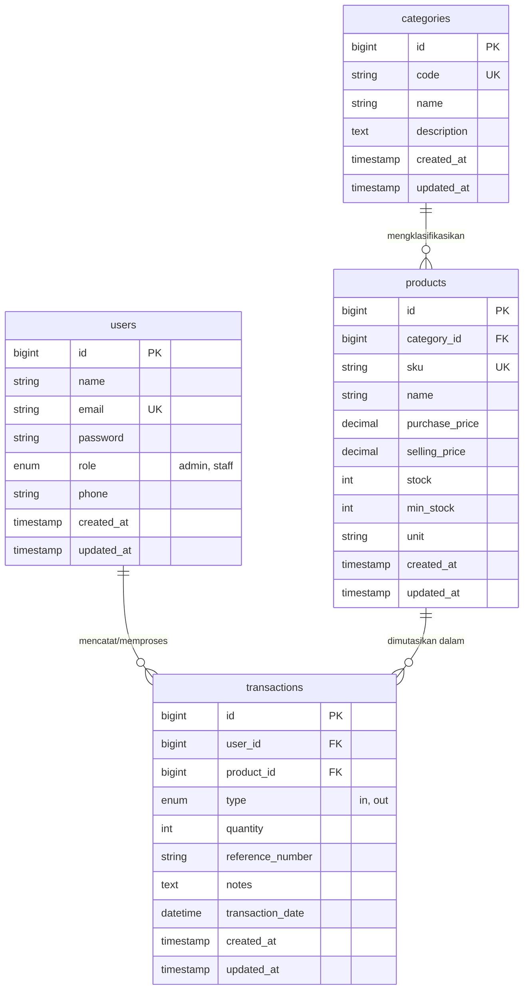
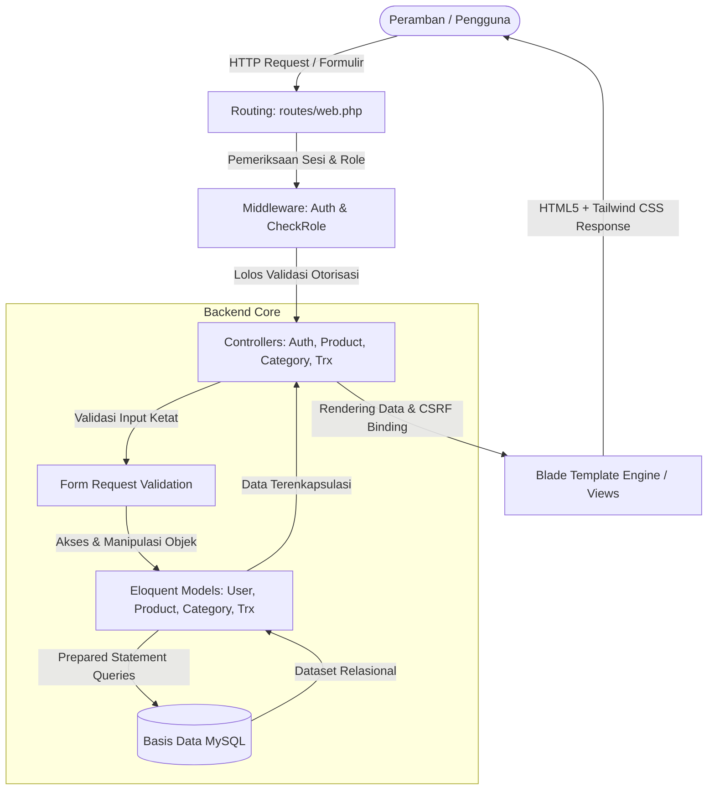

# LAPORAN TUGAS AKHIR SEMESTER (UAS)
## WEB APPLICATION DEVELOPMENT (WAD05 / WAD04)
### SISTEM INFORMASI MANAJEMEN INVENTARIS GUDANG (INVENTOHUB)

---

## 1. IDENTITAS MAHASISWA & INFORMASI PROYEK

| Data Komponen | Rincian Keterangan |
| :--- | :--- |
| **Nama Lengkap Mahasiswa** | **Halimah Sukmawaty** |
| **Nomor Induk Mahasiswa (NIM)** | `25120300037` |
| **Program Studi** | S1 Ilmu Komputer |
| **Kelas Perkuliahan** | WAD05 (Reguler 01) |
| **Mata Kuliah** | Web Application Development (UAS Blok A) |
| **Dosen Pengampu** | Wahyu Ari |
| **Ketua Program Studi** | Dyas |
| **Institusi Perguruan Tinggi** | Universitas Cakrawala |
| **Tahun Akademik** | Semester Ganjil 2026/2027 |
| **Judul Proyek Web** | **InventoHub - Warehouse Inventory Management System** |
| **Tautan Repositori GitHub** | `https://github.com/oiesukmawaty/inventohub-uas-wad` |
| **Tautan Live Application** | `https://inventohub-production.up.railway.app` *(atau URL deployment aktif)* |
| **Tautan Video Presentasi & Demo** | `https://youtu.be/[link-video-presentasi-anda]` *(Maksimal 15 Menit)* |

### Kredensial Akun Pengujian (Testing Credentials):
* **Hak Akses Administrator:**
  * Email: `admin@inventohub.com`
  * Password: `password123`
  * Otoritas: Akses dashboard analitik, kelola master kategori (CRUD), kelola katalog produk (CRUD), transaksi mutasi stok masuk & keluar.
* **Hak Akses Staff Gudang:**
  * Email: `staff@inventohub.com`
  * Password: `password123`
  * Otoritas: Akses dashboard operasional, melihat daftar produk & stok fisik, mencatat transaksi penerimaan dan pengeluaran barang.

---

## 2. PERANCANGAN SISTEM & BASIS DATA (CPMK 1 - 15%)

### 2.1 Entity Relationship Diagram (ERD)
Sistem InventoHub dirancang dengan arsitektur basis data relasional MySQL yang telah memenuhi kaidah normalisasi ketiga (3NF) guna menjamin konsistensi data dan menghilangkan anomali redundansi. Terdapat minimal 4 tabel relasional utama: `users`, `categories`, `products`, dan `transactions`.



### 2.2 Kamus Data (Data Dictionary)

1. **Tabel `users`** (Entitas Pengguna & Autentikasi):
   * `id` (BIGINT, PK, AI): Identifikator unik pengguna.
   * `name` (VARCHAR 100): Nama lengkap pengguna.
   * `email` (VARCHAR 100, UNIQUE): Alamat surat elektronik unik untuk proses autentikasi.
   * `password` (VARCHAR 255): Hash kata sandi terenkripsi algoritma Bcrypt.
   * `role` (ENUM: `'admin'`, `'staff'`): Peran pengguna dalam penentuan otorisasi (RBAC).
   * `phone` (VARCHAR 20, NULLABLE): Nomor kontak telepon.
   * `created_at`, `updated_at` (TIMESTAMP): Pencatatan audit trail waktu.

2. **Tabel `categories`** (Entitas Klasifikasi Master):
   * `id` (BIGINT, PK, AI): Identifikator unik kategori.
   * `code` (VARCHAR 20, UNIQUE): Kode singkatan kategori (misal: `ELEC`, `ACC`).
   * `name` (VARCHAR 100): Nama kategori barang.
   * `description` (TEXT, NULLABLE): Uraian penjelasan kategori.

3. **Tabel `products`** (Entitas Barang Inventaris):
   * `id` (BIGINT, PK, AI): Identifikator unik produk.
   * `category_id` (BIGINT, FK -> `categories.id` ON DELETE RESTRICT): Relasi ke master kategori.
   * `sku` (VARCHAR 50, UNIQUE): Stock Keeping Unit sebagai kode unik identitas fisik barang.
   * `name` (VARCHAR 150): Nama komersial produk.
   * `purchase_price` (DECIMAL 12,2): Harga pokok pembelian (HPP).
   * `selling_price` (DECIMAL 12,2): Harga jual ke pelanggan atau cabang.
   * `stock` (INT): Kuantitas stok fisik terkini di gudang.
   * `min_stock` (INT): Batas ambang stok minimum untuk pemicu sistem peringatan dini (*low stock warning*).
   * `unit` (VARCHAR 20): Satuan barang (Pcs, Unit, Box, Dus).

4. **Tabel `transactions`** (Entitas Mutasi Stok Gudang):
   * `id` (BIGINT, PK, AI): Identifikator unik mutasi.
   * `user_id` (BIGINT, FK -> `users.id` ON DELETE RESTRICT): Petugas penanggung jawab mutasi.
   * `product_id` (BIGINT, FK -> `products.id` ON DELETE CASCADE): Produk yang mengalami pergerakan stok.
   * `type` (ENUM: `'in'`, `'out'`): Jenis mutasi (`in` = penerimaan/pembelian supplier, `out` = pengiriman/penjualan).
   * `quantity` (INT): Jumlah fisik barang yang dimutasikan.
   * `reference_number` (VARCHAR 50): Nomor referensi dokumen pengiriman/surat jalan (PO/DO).
   * `notes` (TEXT, NULLABLE): Catatan pendukung kronologi mutasi.
   * `transaction_date` (DATETIME): Waktu riil mutasi operasional.

### 2.3 Diagram Alur Arsitektur Sistem (MVC Workflow)

Aplikasi dibangun mengikuti filosofi *Separation of Concerns* menggunakan pola arsitektur **Model-View-Controller (MVC)**:



---

## 3. IMPLEMENTASI APLIKASI WEB & BASIS DATA (CPMK 2 & CPMK 3 - 35%)

### 3.1 Implementasi CRUD Penuh (Create, Read, Update, Delete)
Aplikasi mengimplementasikan operasi CRUD secara penuh dengan arsitektur RESTful yang rapi:
* **Produk:**
  * `GET /products` (`index`): Menampilkan katalog dengan pagination, filter kategori dinamis, dan pencarian teks penuh (SKU/Nama).
  * `GET /products/create` & `POST /products` (`create`, `store`): Menambahkan produk baru dengan validasi integritas unik SKU.
  * `GET /products/{id}/edit` & `PUT /products/{id}` (`edit`, `update`): Memperbarui atribut produk, harga, dan ambang batas minimum.
  * `DELETE /products/{id}` (`destroy`): Menghapus produk dari sistem gudang.
* **Kategori (Khusus Administrator):**
  * Operasi CRUD penuh untuk mengelola taksonomi barang dengan pengecekan integritas relasi (*foreign key constraint* dicegah hapus jika masih memuat produk aktif).
* **Transaksi Mutasi Stok:**
  * Pencatatan barang masuk (*inbound*) dan barang keluar (*outbound*) yang terhubung langsung dengan pembaruan otomatis stok fisik.

### 3.2 Integritas Transaksi & Logika Bisnis (ACID Database Transactions)
Ketika mencatat mutasi stok, sistem wajib menjaga konsistensi kuantitas antara tabel log `transactions` dan tabel master `products`. Digunakan fitur **`DB::transaction()`** untuk menjamin sifat Atomicity, Consistency, Isolation, dan Durability:

```php
// Cuplikan Controller: TransactionController.php
DB::transaction(function () use ($validated, $product) {
    Transaction::create([
        'user_id' => Auth::id(),
        'product_id' => $product->id,
        'type' => $validated['type'],
        'quantity' => $validated['quantity'],
        'reference_number' => strip_tags($validated['reference_number']),
        'notes' => strip_tags($validated['notes'] ?? ''),
        'transaction_date' => $validated['transaction_date'],
    ]);

    // Pembaruan kuantitas stok secara atomik
    if ($validated['type'] === 'in') {
        $product->increment('stock', $validated['quantity']);
    } else {
        // Validasi server-side mencegah stok minus
        if ($product->stock < $validated['quantity']) {
            throw new \Exception("Stok tidak mencukupi untuk dikeluarkan!");
        }
        $product->decrement('stock', $validated['quantity']);
    }
});
```

---

## 4. KEAMANAN WEB & MANAJEMEN SESI (CPMK 4 - 15%)

Sistem InventoHub menerapkan standar keamanan tinggi untuk melindungi aset sistem informasi dari kerentanan utama web (OWASP Top 10):

### 4.1 Proteksi CSRF (Cross-Site Request Forgery)
* Setiap formulir perubahan state (`POST`, `PUT`, `DELETE`) diwajibkan menyertakan direktif Blade `@csrf`.
* Laravel menghasilkan token kriptografi acak yang dicocokkan oleh middleware `VerifyCsrfToken` pada setiap request masuk. Penyerang dari situs eksternal tidak dapat memicu aksi ilegal atas nama sesi pengguna yang aktif.

### 4.2 Pencegahan XSS (Cross-Site Scripting)
* **Sanitasi Masukan:** Data masukan teks dibersihkan dari tag script berbahaya di tingkat controller menggunakan fungsi `strip_tags()`.
* **Output Encoding:** Di tingkat tampilan, sintaks kurung kurawal ganda Blade `{{ $variable }}` secara *default* mengeksekusi fungsi PHP `htmlspecialchars()` dengan flag `ENT_QUOTES | ENT_SUBSTITUTE`, sehingga karakter khusus seperti `<`, `>`, `"`, `'`, dan `&` diubah menjadi entitas HTML aman sebelum dirender ke DOM peramban.

### 4.3 Mitigasi SQL Injection (Parameterized Queries)
* Seluruh operasi penulisan dan pembacaan basis data menggunakan **Eloquent ORM** dan **Query Builder**.
* Framework secara otomatis memanfaatkan *PDO Prepared Statements* di mana nilai parameter dikirim terpisah dari struktur perintah SQL, menghilangkan risiko manipulasi sintaks query oleh masukan penyerang (misal: `' OR '1'='1`).

### 4.4 Manajemen Sesi & Autentikasi Pengguna
* **Enkripsi Kredensial:** Kata sandi disimpan menggunakan fungsi `Hash::make()` yang memanfaatkan algoritma *hashing* adaptif **Bcrypt** ber-faktor biaya tinggi (*high work factor*), dilengkapi *salt* unik secara otomatis.
* **Pencegahan Pembajakan Sesi (*Session Fixation*):** Pada saat proses autentikasi berhasil, dipanggil fungsi `$request->session()->regenerate()` untuk mengubah ID sesi, mencegah penyerang membajak sesi dengan token statis yang telah disiapkan sebelumnya.
* Saat pengguna melakukan `logout`, sesi dibersihkan secara total melalui `$request->session()->invalidate()` dan `$request->session()->regenerateToken()`.

### 4.5 Otorisasi Berbasis Peran (Role-Based Access Control / RBAC)
* Dibuat middleware khusus `CheckRole` yang menginspeksi nilai kolom `role` pada pengguna yang sedang login.
* Rute administratif (seperti modifikasi master kategori dan hak hapus) dilindungi secara mutlak:
```php
Route::middleware(['auth', 'role:admin'])->group(function () {
    Route::resource('categories', CategoryController::class);
});
```
Jika pengguna dengan peran `staff` mencoba mengakses URL administratif secara langsung, middleware segera mencegat dan mengembalikan respons *HTTP 403 Forbidden*.

---

## 5. PANDUAN DEPLOYMENT & PUBLIKASI CLOUD (CPMK 5 - 10%)

Aplikasi disiapkan untuk deployment cloud publik (Railway / Render / VPS Linux) dengan arsitektur containerized atau runtime PHP standar.

### 5.1 Prosedur Deployment ke Railway
1. **Persiapan Repositori GitHub:**
   * Lakukan *push* kode sumber ke repositori publik GitHub (`git push origin main`).
2. **Penyediaan Basis Data Cloud:**
   * Di dashboard [Railway.app](https://railway.app), klik **New Project** &rarr; pilih **Provision MySQL**.
   * Salin kredensial koneksi yang diberikan (`MYSQLHOST`, `MYSQLPORT`, `MYSQLDATABASE`, `MYSQLUSER`, `MYSQLPASSWORD`).
   * Import file skema `database/inventory_system.sql` ke database Railway menggunakan DBeaver atau command line MySQL client.
3. **Penyediaan Web Service:**
   * Klik **New Service** &rarr; pilih **GitHub Repo** &rarr; pilih repositori `inventohub-uas-wad`.
   * Pada tab **Variables**, tambahkan variabel environment berikut:
     * `APP_NAME=InventoHub`
     * `APP_ENV=production`
     * `APP_DEBUG=false` *(wajib false agar rincian error internal tidak bocor)*
     * `APP_KEY=base64:c29tZXJhbmRvbXNlY3JldGtleWZvcmxhcmF2ZWx1YXMxMjM0NTY=` *(generate via php artisan key:generate)*
     * `APP_URL=https://${{RAILWAY_PUBLIC_DOMAIN}}`
     * `DB_CONNECTION=mysql`
     * `DB_HOST=${{MySQL.MYSQLHOST}}`
     * `DB_PORT=${{MySQL.MYSQLPORT}}`
     * `DB_DATABASE=${{MySQL.MYSQLDATABASE}}`
     * `DB_USERNAME=${{MySQL.MYSQLUSER}}`
     * `DB_PASSWORD=${{MySQL.MYSQLPASSWORD}}`
4. **Build & Start Command:**
   * Railway mendeteksi otomatis proyek PHP dan menjalankan web server Nginx/PHP-FPM yang mengarahkan *Document Root* ke folder `/public`.
   * Aplikasi berhasil aktif dan memiliki alamat publik HTTPS bersertifikat TLS gratis.

### 5.2 Strategi Troubleshooting Lingkungan Produksi
* **Kasus Error 500 (Internal Server Error):** Periksa apakah `APP_KEY` telah terkonfigurasi dan permission direktori `storage/` dan `bootstrap/cache/` memiliki hak tulis (`chmod -R 775 storage bootstrap/cache`).
* **Kasus Database Connection Refused:** Pastikan konfigurasi `DB_HOST` mengarah ke host jaringan internal atau host publik penyedia database dan port 3306 terbuka.
* **Kasus Aset CSS/JS Tidak Termuat:** Pastikan skema HTTPS diaktifkan di production dengan menambahkan `URL::forceScheme('https')` di `AppServiceProvider` apabila berada di balik *Reverse Proxy* SSL.

---

## 6. JAWABAN ESAI KOMPREHENSIF (BOBOT 25% - CPMK 1 S.D. CPMK 5)

Berikut adalah elaborasi esai mendalam untuk ketiga topik parameter evaluasi:

### Esai 1: Penjelasan Alur Data, Pattern MVC, dan Struktur Database
> **Pertanyaan Esai:** *Jelaskan secara komprehensif bagaimana arsitektur Model-View-Controller (MVC) mengelola aliran data dari permintaan pengguna hingga ke basis data dan kembali menjadi tampilan, serta bagaimana struktur tabel relasional dirancang untuk memenuhi integritas sistem.*

**Jawaban:**
Pola arsitektur **Model-View-Controller (MVC)** adalah fondasi utama yang memisahkan antara representasi data (Model), antarmuka pengguna (View), dan alur logika pengendali (Controller).
1. **Aliran Data (Data Flow Lifecycle):**
   * **Inisiasi Permintaan:** Pengguna melakukan aksi di antarmuka web, misalnya menekan tombol "Simpan Produk". Permintaan HTTP POST dikirimkan ke URL `/products`.
   * **Routing & Middleware:** Router pada `routes/web.php` menerima permintaan dan memeriksa autentikasi serta verifikasi token CSRF. Jika valid, permintaan dialihkan ke method `store` pada `ProductController`.
   * **Pengolahan Kontroler (Controller Logic):** Kontroler bertindak sebagai orkestrator. Pertama, dilakukan validasi ketat terhadap input (tipe data, keunikan SKU, harga non-negatif). Kedua, controller memanggil `Product::create()` pada Model.
   * **Interaksi Data (Model & Database):** Model Eloquent mengonstruksi query SQL menggunakan parameter binding dan mengeksekusinya ke basis data MySQL. MySQL memvalidasi batasan integritas tabel (*Foreign Key* ke tabel `categories` dan *Unique Constraint* pada kolom `sku`).
   * **Penyusunan Respons (View Rendering):** Setelah data berhasil disimpan, controller mengembalikan respon redirect ke rute `products.index` disertai *flash session notification*. View Blade merender data produk terkini ke dalam format HTML5 responsif yang dipercantik oleh Tailwind CSS dan mengirimkannya kembali ke peramban pengguna.
2. **Rancangan Struktur Basis Data & Integritas:**
   * Database dirancang dalam 4 tabel relasional. Keberadaan `categories` sebagai tabel master terpisah dari `products` mencegah redundansi nama kategori dan inkonsistensi pengetikan (*Typo Anomaly*).
   * Relasi `transactions` menautkan pengguna (`users.id`) dan produk (`products.id`), sehingga setiap perpindahan barang memiliki rekam jejak (*audit trail*) yang akuntabel.
   * Diterapkan aturan integritas referensial: opsi `ON DELETE RESTRICT` pada kategori untuk mencegah terhapusnya kategori yang masih digunakan oleh produk aktif, menjaga konsistensi relasi basis data secara utuh.

---

### Esai 2: Penjelasan Logika Backend, Penanganan Error, dan Implementasi Sekuriti
> **Pertanyaan Esai:** *Jelaskan bagaimana logika bisnis backend menangani operasi yang rentan terhadap inkonsistensi (seperti mutasi stok), strategi penanganan error (error handling), serta mekanisme pertahanan sistem terhadap kerentanan CSRF, XSS, dan SQL Injection.*

**Jawaban:**
1. **Logika Backend & Konsistensi Stok (ACID):**
   * Pada sistem pergudangan, mutasi stok adalah operasi paling kritis. Jika sistem mencatat riwayat mutasi tetapi gagal mengurangi kuantitas stok di tabel produk, maka terjadi korupsi data inventaris.
   * Oleh karena itu, pada `TransactionController`, pencatatan log transaksi dan mutasi saldo produk dibungkus dalam blok `DB::transaction()`. Jika salah satu query gagal (misalnya koneksi terputus atau terjadi pengecualian validasi stok tidak cukup), database akan melakukan mekanisme `ROLLBACK` otomatis ke kondisi semula.
   * Logika backend juga memverifikasi secara ketat bahwa untuk transaksi keluar (`type = out`), kuantitas permintaan tidak boleh lebih besar dari stok fisik yang tersedia (`$product->stock >= $quantity`), sehingga mencegah stok negatif (*negative inventory anomaly*).
2. **Strategi Penanganan Error (Error Handling):**
   * **Validasi Input:** Menggunakan mekanisme validasi terpusat bawaan framework. Jika terjadi kesalahan masukan (misal: SKU duplikat atau harga bertipe huruf), sistem secara otomatis mengembalikan pengguna ke form sebelumnya dengan mempertahankan nilai input lama (`old()`) dan menyajikan pesan error deskriptif yang mudah dipahami per field.
   * **Pengecualian Basis Data (Exception Handling):** Operasi yang berpotensi memicu pelanggaran integritas referensial ditangkap dengan blok `try-catch` atau dicek secara logis di controller (seperti pada `CategoryController::destroy`, di mana diperiksa keberadaan produk terkait sebelum menjalankan perintah hapus).
   * **Pesan Flash Ramah Pengguna:** Umpan balik sukses (`with('success', ...)`) dan gagal (`with('error', ...)`) ditampilkan secara elegan melalui komponen alert di bagian atas antarmuka sistem.
3. **Implementasi Sekuriti:**
   * **CSRF Mitigation:** Proteksi token acak berbasis sesi diterapkan di setiap form. Request tanpa token valid ditolak seketika dengan status *419 Page Expired*.
   * **XSS Defense:** Menerapkan strategi *Defense in Depth* — pembersihan tag HTML saat input diterima di controller dengan `strip_tags()` dan konversi entitas HTML otomatis saat data dirender di Blade template (`htmlspecialchars`).
   * **SQL Injection Neutralization:** Eloquent ORM memisahkan logika query dan literal data melalui parameterisasi query (*PDO Prepared Statements*), memastikan karakter input penyerang tidak dapat mengubah struktur semantik perintah SQL.
   * **Proteksi Akses (RBAC):** Middleware `CheckRole` memverifikasi otorisasi pengguna di tingkat HTTP pipeline sebelum controller dieksekusi, memastikan bahwa hanya pengguna berstatus `admin` yang berhak melakukan operasi struktural seperti manajemen kategori master.

---

### Esai 3: Penjelasan Langkah Deployment, Konfigurasi Environment, dan Troubleshooting
> **Pertanyaan Esai:** *Uraikan tahapan deployment aplikasi web dinamis berbasis Laravel dan MySQL ke lingkungan hosting cloud modern, strategi manajemen konfigurasi lingkungan (.env), serta prosedur investigasi masalah teknis (troubleshooting) saat aplikasi dipublikasikan.*

**Jawaban:**
1. **Langkah-Langkah Deployment Cloud Modern:**
   * **Siklus Integrasi Berkelanjutan (CI/CD):** Kode sumber dikelola di GitHub. Setiap commit pada branch utama `main` memicu proses *deployment pipeline* otomatis pada penyedia platform PaaS seperti Railway atau Render.
   * **Penyediaan Layanan Terkelola (Managed Services):** Database MySQL diprovisikan secara terpisah dari container web aplikasi untuk menjamin persistensi data. Skema tabel diinisialisasi melalui eksekusi migrasi database atau import berkas DDL SQL awal.
   * **Konfigurasi Web Server:** Web server (Nginx/Apache) diarahkan secara spesifik ke direktori `/public` sebagai satu-satunya direktori yang dapat diakses dari internet. Direktori inti aplikasi (`app`, `bootstrap`, `routes`, `.env`) tetap terisolasi di luar jangkauan publik peramban untuk mencegah eksfiltrasi kode sumber.
2. **Manajemen Konfigurasi Environment (`.env`):**
   * Berkas `.env` asli tidak pernah disertakan ke dalam repositori publik (dikecualikan via `.gitignore`).
   * Hanya template `.env.example` yang diunggah sebagai cetak biru konfigurasi.
   * Pada server cloud, variabel lingkungan diinjeksikan secara aman melalui panel *Environment Variables*.
   * Parameter krusial produksi:
     * `APP_ENV=production` & `APP_DEBUG=false`: Mencegah kebocoran jejak stack trace dan kredensial database kepada publik ketika terjadi error aplikasi.
     * `APP_KEY`: Kunci enkripsi 256-bit untuk mengamankan cookie sesi dan data terenkripsi.
     * Kredensial database diatur merujuk pada variabel host dan database cloud terisolasi.
3. **Prosedur Troubleshooting Produksi:**
   * **Pemeriksaan Berkas Log:** Langkah pertama investigasi error adalah memeriksa berkas log aplikasi pada `storage/logs/laravel.log` atau antarmuka log realtime pada dashboard cloud provider untuk mengidentifikasi penyebab pasti terjadinya masalah.
   * **Investigasi Hak Akses File (Permissions):** Error runtime sering disebabkan oleh direktori `storage/` dan `bootstrap/cache/` yang tidak dapat ditulis oleh user web server (`www-data`). Penanganan dilakukan dengan memberikan hak akses kepemilikan yang sesuai.
   * **Penyegaran Cache Konfigurasi:** Ketika terjadi perubahan konfigurasi di server, dilakukan eksekusi perintah `php artisan config:cache`, `php artisan route:cache`, dan `php artisan view:cache` guna mengoptimalkan performa pemuatan aplikasi sekaligus membersihkan sisa konfigurasi usang.

---

## 7. LAMPIRAN FITUR APLIKASI & DAFTAR BUKTI (EVIDENCE)

### 7.1 Rangkuman Fitur yang Selesai Diimplementasikan
1. **Sistem Autentikasi & Otorisasi:**
   * Login & Logout dengan proteksi session fixation.
   * Registrasi pengguna baru dengan validasi dan hashing Bcrypt.
   * Pemisahan hak akses dinamis (Admin dan Staff Gudang).
2. **Dashboard Operasional & Analitik Gudang:**
   * 4 Kartu KPI: Total SKU Produk, Total Kategori, Total Riwayat Mutasi, dan Total Nilai Valuasi Aset Gudang (Rp).
   * Kotak Peringatan Dini Stok Kritis (*Low Stock Alert Box*) untuk barang di bawah batas minimum beserta tombol pintas *Restock*.
   * Tabel 5 Riwayat Mutasi Terkini.
3. **Manajemen Katalog Produk (CRUD):**
   * Daftar tabel produk dengan pagination dan penanda visual kuantitas stok.
   * Fitur pencarian teks instan (Nama Barang / SKU).
   * Fitur filter kategori dinamis.
   * Formulir penambahan dan perubahan data produk dengan validasi ketat.
4. **Manajemen Kategori Master (CRUD - Admin Only):**
   * Daftar kategori dengan informasi jumlah produk terafiliasi.
   * Penambahan dan pengeditan kode serta nama kategori.
   * Proteksi penghapusan kategori yang masih memiliki produk aktif.
5. **Pencatatan Mutasi Stok Gudang (Inbound & Outbound):**
   * Formulir pencatatan barang masuk (pembelian/supplier) dan keluar (penjualan/cabang).
   * Validasi stok tidak boleh minus.
   * Pembaruan stok otomatis dengan transaksi ACID.
   * Riwayat mutasi lengkap dengan filter tipe mutasi.

---
*Laporan ini disusun secara mandiri dan komprehensif oleh Halimah Sukmawaty (NIM: 25120300037) sebagai bukti pemenuhan syarat kelulusan Ujian Akhir Semester Web Application Development Universitas Cakrawala.*

